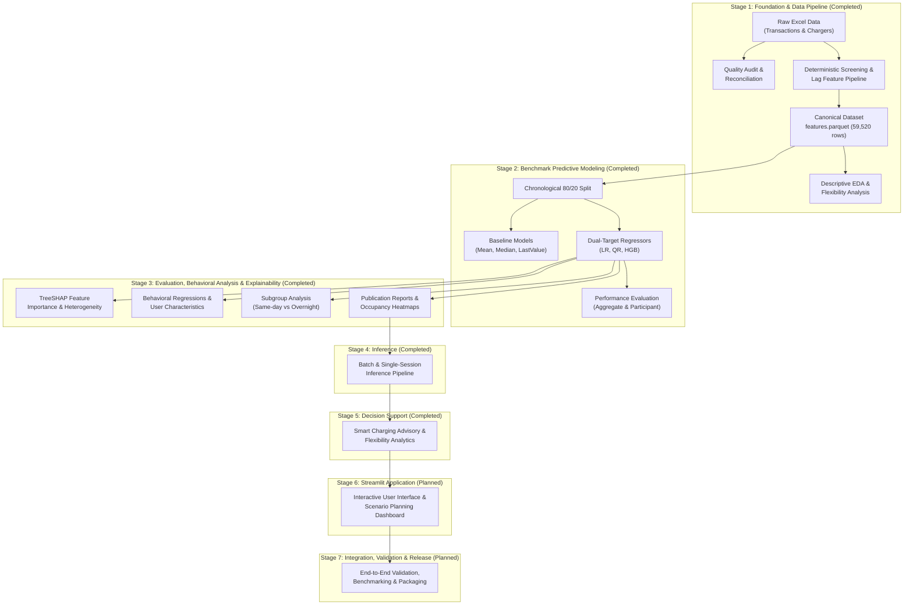

# TARANG — Architecture and Project Structure

**Domain**: Electric Vehicle Charging Intelligence System  
**Current Stage**: Stage 5 — Decision Support  
**Repository**: `nayanojwal0810/Tarang`

---

## 1. System Overview

TARANG is an end-to-end Electric Vehicle (EV) Charging Intelligence System designed to predict charging session behaviors and provide data-driven decision support for smart charging, managed load shifting, and bay occupancy planning.

At arrival time ($t_0$), the system predicts two operational targets:
1. **Plugged-In Duration (`Duration`)**: Bay occupancy time in hours, capped at 336.0 hours for modeling.
2. **Energy Consumption (`ConsumedkWh`)**: Active energy delivered to the battery in kilowatt-hours.

The architecture is built on a clean, modular Python package structure adhering to strict anti-leakage boundaries, robust data schemas, reproducible data processing pipelines, and production-grade software engineering.

---

## 2. Directory Layout

```
Tarang/
|-- .github/
|   |-- workflows/
|       |-- ci.yml                   # Automated continuous integration test suite
|
|-- data/
|   |-- raw/
|   |   |-- electric_nation/         # Source trial Excel workbooks (excluded from Git)
|   |-- processed/
|       |-- electric_nation/         # Canonical Parquet datasets and summary JSON (excluded from Git)
|
|-- docs/
|   |-- architecture/
|   |   |-- project_structure.md     # Architecture documentation and module responsibilities
|   |-- data/
|       |-- data_contract.md         # Schema rules, anti-leakage boundaries, and screening sequence
|       |-- data_dictionary.md       # Raw and canonical column definitions, units, and ranges
|   |-- inference/
|       |-- inference_contract.md    # Stage 4 single-session and batch inference contract
|   |-- decision_support/
|       |-- decision_support_contract.md # Stage 5 advisory schema, physical validity, and flexibility contract
|
|-- reports/
|   |-- data_audit/                  # Quality audit report (dataset_audit_report.md) and CSV summaries
|   |-- eda/                         # Exploratory data analysis report (eda_summary.md) and visual plots
|   |-- modeling/
|       |-- duration/                # Duration evaluation report, figures, heatmaps, and metrics
|       |-- energy/                  # Energy evaluation report, figures, and metrics
|   |-- decision_support/            # Stage 5 prediction and flexibility summaries and operational report
|
|-- scripts/
|   |-- run_data_audit.py            # CLI entry point: run data quality audit
|   |-- prepare_data.py              # CLI entry point: data screening and feature engineering
|   |-- run_eda.py                   # CLI entry point: run exploratory data analysis and plot figures
|   |-- run_modeling.py              # CLI entry point: dual-target regression benchmark pipeline
|   |-- run_evaluation.py            # CLI entry point: model evaluation, TreeSHAP, and subgroup analysis
|   |-- run_inference.py             # CLI entry point: batch inference on pre-engineered feature sets
|   |-- run_decision_support.py      # CLI entry point: batch decision support, occupancy, and flexibility
|
|-- src/
|   |-- tarang/
|       |-- __init__.py
|       |-- config.py                # Global configurations, file paths, and schema schemas
|       |-- data/                    # Data ingestion, validation, audit, and screening
|       |   |-- __init__.py
|       |   |-- loading.py           # Robust Excel/Parquet loading with validation
|       |   |-- validation.py        # Schema validation and timestamp verification
|       |   |-- quality_audit.py     # Quality auditing (overlaps, missingness, reconciliation)
|       |   |-- screening.py         # Exact research-grade participant screening pipeline
|       |   |-- preparation.py       # High-level pipeline orchestration and parquet persistence
|       |   |-- audit_reporting.py   # Dynamic Markdown and CSV audit report generator
|       |   |-- audit.py             # Backward-compatible facade for legacy audit calls
|       |-- features/                # Feature engineering modules
|       |   |-- __init__.py
|       |   |-- calendar_features.py # UK Bank Holidays, weekend/weekday override, day indicators
|       |   |-- time_features.py     # StartHour, StartHourNorm, cyclical StartCos / StartSin
|       |   |-- historical_features.py # TimeSinceLastStop, sessionsToday, LastDuration, LastConsumedkWh
|       |   |-- feature_engineering.py # Authoritative 13 feature definitions and extraction
|       |-- modeling/                # Predictive modeling and benchmark regressors
|       |   |-- __init__.py
|       |   |-- models.py            # Benchmark regressors (LR, QR, HGB) and baselines (Mean, Median, LastValue)
|       |   |-- metrics.py           # Reference-aligned evaluation metrics and error distribution statistics
|       |   |-- experiment.py        # Chronological split, training, evaluation, and artifact persistence
|       |-- evaluation/              # Model evaluation, behavioral analysis, and explainability
|       |   |-- __init__.py
|       |   |-- loading.py           # MultiIndex performance, predictions, and model loader
|       |   |-- analysis.py          # Benchmark tables, user characteristics, model agreement, seasonality
|       |   |-- explainability.py    # TreeSHAP feature importance (global and vehicle distributions)
|       |   |-- subgroup_analysis.py # Same-day vs overnight session partitioning and modeling
|       |   |-- visualizations.py    # Publication-ready Matplotlib figures matching reference styling
|       |   |-- reporting.py         # Dynamic Markdown evaluation report generator
|       |-- inference/               # Single-session and batch inference pipeline
|       |   |-- __init__.py
|       |   |-- loading.py           # Model artifact and summary loader with caching
|       |   |-- validation.py        # Feature schema and session history validation
|       |   |-- feature_builder.py   # Single-session 13-predictor construction from history
|       |   |-- engine.py            # Low-latency prediction engine (predict_single, predict_batch)
|       |-- decision_support/        # Stage 5 session occupancy and flexibility advisory layer
|       |   |-- __init__.py
|       |   |-- engine.py            # DecisionSupportEngine, SessionAdvisory, validity & unplug calculation
|       |   |-- flexibility.py       # Smart-charging flexibility analysis wrapper
|       |   |-- reporting.py         # Summary tables and operational Markdown report generator
|       |-- analysis/                # Statistical analysis and EDA
|       |   |-- __init__.py
|       |   |-- exploratory_data_analysis.py # Availability, flexibility, and bivariate distributions
|       |-- visualization/           # Visualization generators
|           |-- __init__.py
|           |-- eda_plots.py         # Multi-panel Matplotlib figures with marginal distributions
|
|-- tests/
|   |-- unit/                        # Fast, isolated unit test suite (audit, screening, features, modeling, inference, decision support)
|   |-- integration/                 # End-to-end integration tests on real and synthetic pipelines
|
|-- .gitignore
|-- pyproject.toml                   # Modern PEP 517/621 package build configuration
|-- README.md                        # User-facing overview, quickstart, and inference guide
```

---

## 3. Module Responsibilities

### 3.1 `tarang.config`
- Single source of truth for all repository paths (`RAW_TX_FILE`, `PROCESSED_FEATURES_FILE`, `REPORTS_DIR`).
- Schema definitions: `REQUIRED_TX_COLUMNS`, `REQUIRED_META_COLUMNS`, `RAW_SELECTED_COLUMNS`, `CANONICAL_COLUMNS`.
- Authoritative feature list (`FEATURE_NAMES`): exactly 13 predictors in standard order.
- Numeric thresholds (`MIN_DURATION_HOURS`, `MAX_DURATION_HOURS`, `MIN_RETAINED_SESSIONS`).

### 3.2 `tarang.data`
- **`loading.py`**: Loads workbooks and Parquet datasets with path verification, logging, and error handling.
- **`validation.py`**: Validates schema compliance, column data types, UTC timestamp awareness, and anti-leakage constraints.
- **`quality_audit.py`**: Performs deep data audits, detecting cumulative maximum overlaps, unlinked sessions, energy plausibility thresholds, and participant reconciliation.
- **`screening.py`**: Executes the deterministic screening sequence:
  1. Trial 3 exclusion (`Trial != 3`).
  2. Retention of 9 primary source fields.
  3. Duration calculation (`StopTime - StartTime`) and short-session exclusion ($< 5$ min).
  4. Duration capping at 336.0 hours (preserving unmodified `StopTime`).
  5. Continuous StartHour, StartHourNorm, and cyclical encoding (StartCos, StartSin) over the entire filtered population (including null participant records).
  6. Per-participant sequential sorting and `TimeSinceLastStop` negative-gap filtering without gap recalculation.
  7. Drop first session per participant.
  8. Minimum history filtering ($\ge 10$ retained sessions).
  9. Observation density rule ($\text{sessions} \ge \text{observation\_days} / 7.0$).
  10. Participant integer `id` assignment from source group enumeration index (`i` in `enumerate(groupby("ParticipantID", sort=True))`), preserving non-contiguous IDs ($1 \dots 298$).
  11. Lag calculations: `sessionsToday` via consecutive-date cumulative counts; `LastDuration` and `LastConsumedkWh` assigned from pre-drop participant history (`dfp.shift(1)[1:]`) so the first retained session receives the dropped preceding session's values.
- **`preparation.py`**: High-level runner that executes screening, validates canonical schema, and persists `features.parquet` (59,520 sessions, 267 participants, 30 columns) and `processing_summary.json`.
- **`audit_reporting.py`**: Formats and exports audit metrics into Markdown (`dataset_audit_report.md`) and CSV summaries.
- **`audit.py`**: Re-export facade maintaining backward compatibility for legacy audit calls.

### 3.3 `tarang.features`
- **`calendar_features.py`**: Implements UK Bank Holiday calendar lookup (exact 13 trial holidays across 2017–2018), holiday override (on holidays both `weekend=0` and `weekday=0`), and 7 binary day-of-week indicators (`Mon` through `Sun`).
- **`time_features.py`**: Computes continuous `StartHour` including fractional minutes and seconds, dataset-wide max normalization (`StartHourNorm`), and periodic trigonometric encodings (`StartCos`, `StartSin`).
- **`historical_features.py`**: Implements lag variables:
  - `TimeSinceLastStop`: Elapsed hours since immediately preceding session stop time.
  - `sessionsToday`: Daily cumulative count of prior sessions on consecutive dates.
  - `LastDuration`: Elapsed duration in hours of immediately preceding session.
  - `LastConsumedkWh`: Metered energy of immediately preceding session.
- **`feature_engineering.py`**: Authoritative specification of `FEATURE_NAMES` and feature extraction utilities.

### 3.4 `tarang.analysis`
- **`exploratory_data_analysis.py`**: Computes empirical summary statistics:
  - Participant data availability (observation span, total sessions, sessions per week, average duration).
  - Bivariate duration vs. start-hour distributions.
  - Bivariate energy vs. start-hour distributions.
  - Smart-charging flexibility ratio ($\text{ChargingDuration} / \text{PluggedInDuration}$) segmented into same-day vs. overnight sessions using UK local time (`Europe/London`).

### 3.5 `tarang.visualization`
- **`eda_plots.py`**: Generates publication-quality, self-contained PNG figures with marginal distributions, log-scale heatmaps, and annotated summary stats.

### 3.6 `tarang.modeling`
- **`models.py`**: Benchmark regression models (`LinearRegression`, `QuantileRegressor`, `HistGradientBoostingRegressor`) and baselines (`MeanValue`, `MedianValue`, and target-specific `LastValue`). Configures model factory in exact reference order.
- **`metrics.py`**: Reference-aligned evaluation metrics (`medae`, `mae`, `medape`, `mape`, `rmse`, `smape`) and error-distribution statistics (`q1`, `q2`, `q3`, and whisker limits `wl`, `wh` for absolute and percentage errors).
- **`experiment.py`**: Validates canonical inputs, performs chronological 80/20 train/test split, trains models, tracks predictions, evaluates aggregate (`ALL`) and per-participant metrics, and persists models and CSV artifacts.

### 3.7 `tarang.evaluation`
- **`loading.py`**: Validated loader for MultiIndex performance matrices, prediction logs, HGBR models, and feature datasets.
- **`analysis.py`**: Benchmark comparison tables, participant distribution statistics, behavioral regressions (OLS against user MdAPE), model agreement, temporal stability, seasonality, and split data availability.
- **`explainability.py`**: TreeSHAP global feature importance ranking and participant-level feature attribution distributions.
- **`subgroup_analysis.py`**: Same-day vs overnight UTC date session partitioning, fresh HGBR training on 80/20 splits, and comparative performance evaluation.
- **`visualizations.py`**: Publication-ready Matplotlib figures matching reference styling (error boxplots, error density, OLS feature fits, model agreement with insets, temporal degradation, seasonality, SHAP summary boxplots, subgroup comparisons, and 4-state charging occupancy heatmaps).
- **`reporting.py`**: Automated dynamic Markdown report synthesis embedding quantitative findings and figures.

### 3.8 `tarang.inference`
- **`loading.py`**: Model artifact loader with in-memory caching and schema validation; dynamic loader for Stage 1 `max_start_hour` from `processing_summary.json` without fallback.
- **`validation.py`**: Strict 13-predictor schema validator enforcing column presence, canonical order, numeric integrity, and non-finite rejection; session input and participant history validation.
- **`feature_builder.py`**: Single-session 13-predictor vector construction from arrival timestamp, vehicle specs, and participant history with exact holiday override, cyclical encoding, 336-hour duration capping, and cold-start rejection.
- **`engine.py`**: Single-session and batch inference engine (`predict_single`, `predict_batch`, `InferenceEngine`) preserving row ordering and index alignment without output clipping or transformation.

### 3.9 `tarang.decision_support`
- **`engine.py`**: Decision support advisory engine (`DecisionSupportEngine`, `SessionAdvisory`, `generate_session_advisory`, `generate_batch_advisories`), non-negativity and finiteness checks (`is_prediction_valid`), and projected unplug timestamp calculations in UTC (yielding `NaT` on invalid predictions).
- **`flexibility.py`**: Smart-charging flexibility analysis wrapper (`analyze_charging_flexibility`), Europe/London local calendar date classification (same-day vs overnight), and graceful schema availability validation.
- **`reporting.py`**: Operational decision support artifact synthesis (`generate_prediction_summary_table`, `generate_flexibility_summary_table`, `generate_decision_support_markdown_report`, `save_decision_support_artifacts`).

---

## 4. Architecture Roadmap

The TARANG codebase is organized to support future stages without requiring architectural restructuring:



1. **Stage 1 — Foundation & Data Pipeline** (Completed): Ingestion, audit, deterministic screening, 13 features, descriptive EDA.
2. **Stage 2 — Benchmark Predictive Modeling** (Completed): Dual-target benchmark models (LR, QR, HGBR) and baselines (Mean, Median, LastValue).
3. **Stage 3 — Model Evaluation, Behavioral Analysis & Explainability** (Completed): TreeSHAP explainability, behavioral regressions, model agreement, temporal stability, subgroup analysis, and publication reports.
4. **Stage 4 — Inference** (Completed): Batch and single-session prediction engine, feature schema enforcement, lag state retrieval, and low-latency inference pipelines.
5. **Stage 5 — Decision Support** (Completed): Smart charging advisory analytics, session occupancy projections (`projected_unplug_time_utc`), validity flags, smart-charging flexibility modeling, and operational decision reporting.
6. **Stage 6 — Streamlit Application** (Planned): Interactive web dashboard for session inspection, predictive intelligence, flexibility visualization, and scenario planning.
7. **Stage 7 — Integration, Validation & Release** (Planned): End-to-end integration testing, system-wide performance benchmarking, release packaging, and user documentation.

> [!NOTE]
> TARANG's predictions and flexibility insights provide **advisory decision support**. The system does not perform automated charger hardware actuation or live grid switching.

