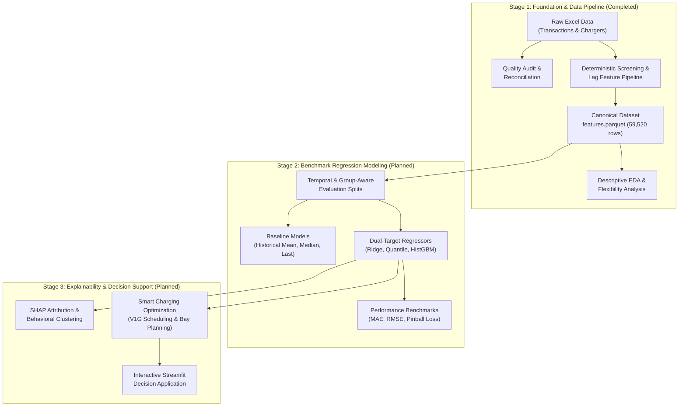

# TARANG — Architecture and Project Structure

**Domain**: Electric Vehicle Charging Intelligence System  
**Current Stage**: Stage 1 — Project Foundation, Data Preparation Pipeline, Feature Engineering, and Exploratory Data Analysis  
**Repository**: `nayanojwal0810/Tarang`

---

## 1. System Overview

TARANG is an end-to-end Electric Vehicle (EV) Charging Intelligence System designed to predict charging session behaviors and provide data-driven decision support for smart charging, managed load shifting, and bay occupancy planning.

At arrival time ($t_0$), the system predicts two operational targets:
1. **Plugged-In Duration (`Duration`)**: Bay occupancy time in hours, capped at 336.0 hours for modeling.
2. **Energy Consumption (`ConsumedkWh`)**: Active energy delivered to the battery in kilowatt-hours.

The architecture is built on a clean, modular Python package structure adhering to strict anti-leakage boundaries, robust data schemas, reproducible data processing pipelines, and production-grade software engineering.

---

## 2. Directory Layout

```
Tarang/
|-- .github/
|   |-- workflows/
|       |-- ci.yml                   # Automated continuous integration test suite
|
|-- data/
|   |-- raw/
|   |   |-- electric_nation/         # Source trial Excel workbooks (excluded from Git)
|   |-- processed/
|       |-- electric_nation/         # Canonical Parquet datasets and summary JSON (excluded from Git)
|
|-- docs/
|   |-- architecture/
|   |   |-- project_structure.md     # Architecture documentation and module responsibilities
|   |-- data/
|       |-- data_contract.md         # Schema rules, anti-leakage boundaries, and screening sequence
|       |-- data_dictionary.md       # Raw and canonical column definitions, units, and ranges
|
|-- reports/
|   |-- data_audit/
|   |   |-- dataset_audit_report.md  # Comprehensive data quality and feasibility audit report
|   |   |-- transaction_quality_summary.csv
|   |   |-- metadata_quality_summary.csv
|   |   |-- participant_reconciliation.csv
|   |   |-- feature_feasibility.csv
|   |-- eda/
|       |-- eda_summary.md           # Descriptive EDA findings and flexibility analysis
|       |-- data_availability.png    # 4-panel participant availability distributions
|       |-- duration_by_start_hour.png # 2D joint histogram of duration vs arrival hour
|       |-- energy_by_start_hour.png   # 2D joint histogram of energy vs arrival hour
|       |-- charging_flexibility.png   # Flexibility ratio distributions (same-day vs overnight)
|
|-- scripts/
|   |-- run_data_audit.py            # CLI entry point: run data quality audit
|   |-- prepare_data.py              # CLI entry point: data screening and feature engineering
|   |-- run_eda.py                   # CLI entry point: run exploratory data analysis and plot figures
|   |-- prepare_modeling_data.py     # Backward-compatible CLI shim for legacy workflows
|
|-- src/
|   |-- tarang/
|       |-- __init__.py
|       |-- config.py                # Global configurations, file paths, and schema schemas
|       |-- data/                    # Data ingestion, validation, audit, and screening
|       |   |-- __init__.py
|       |   |-- loading.py           # Robust Excel/Parquet loading with validation
|       |   |-- validation.py        # Schema validation and timestamp verification
|       |   |-- quality_audit.py     # Quality auditing (overlaps, missingness, reconciliation)
|       |   |-- screening.py         # Exact research-grade participant screening pipeline
|       |   |-- preparation.py       # High-level pipeline orchestration and parquet persistence
|       |   |-- audit_reporting.py   # Dynamic Markdown and CSV audit report generator
|       |   |-- audit.py             # Backward-compatible facade for legacy audit calls
|       |   |-- preprocessing.py     # Backward-compatible facade for legacy preprocessing calls
|       |-- features/                # Feature engineering modules
|       |   |-- __init__.py
|       |   |-- calendar_features.py # UK Bank Holidays, weekend/weekday override, day indicators
|       |   |-- time_features.py     # StartHour, StartHourNorm, cyclical StartCos / StartSin
|       |   |-- historical_features.py # TimeSinceLastStop, sessionsToday, LastDuration, LastConsumedkWh
|       |   |-- feature_engineering.py # Authoritative 13 feature definitions and extraction
|       |-- analysis/                # Statistical analysis and EDA
|       |   |-- __init__.py
|       |   |-- exploratory_data_analysis.py # Availability, flexibility, and bivariate distributions
|       |-- visualization/           # Visualization generators
|           |-- __init__.py
|           |-- eda_plots.py         # Multi-panel Matplotlib figures with marginal distributions
|
|-- tests/
|   |-- __init__.py
|   |-- unit/                        # Fast, isolated unit test suite (54 tests)
|   |   |-- test_audit.py
|   |   |-- test_loading.py
|   |   |-- test_screening.py
|   |   |-- test_features.py
|   |   |-- test_eda.py
|   |-- integration/                 # End-to-end integration tests on real workbooks (2 tests)
|       |-- test_data_pipeline.py
|
|-- .gitignore
|-- pyproject.toml                   # Modern PEP 517/621 package build configuration
|-- pytest.ini                       # Test configuration
|-- requirements.txt                 # Pinned dependencies
|-- README.md
```

---

## 3. Module Responsibilities

### 3.1 `tarang.config`
- Single source of truth for all repository paths (`RAW_TX_FILE`, `PROCESSED_FEATURES_FILE`, `REPORTS_DIR`).
- Schema definitions: `REQUIRED_TX_COLUMNS`, `REQUIRED_META_COLUMNS`, `RAW_SELECTED_COLUMNS`, `CANONICAL_COLUMNS`.
- Authoritative feature list (`FEATURE_NAMES`): exactly 13 predictors in standard order.
- Numeric thresholds (`MIN_DURATION_HOURS`, `MAX_DURATION_HOURS`, `MIN_RETAINED_SESSIONS`).

### 3.2 `tarang.data`
- **`loading.py`**: Loads workbooks and Parquet datasets with path verification, logging, and error handling.
- **`validation.py`**: Validates schema compliance, column data types, UTC timestamp awareness, and anti-leakage constraints.
- **`quality_audit.py`**: Performs deep data audits, detecting cumulative maximum overlaps, unlinked sessions, energy plausibility thresholds, and participant reconciliation.
- **`screening.py`**: Executes the deterministic screening sequence:
  1. Trial 3 exclusion (`Trial != 3`).
  2. Retention of 9 primary source fields.
  3. Duration calculation (`StopTime - StartTime`) and short-session exclusion ($< 5$ min).
  4. Duration capping at 336.0 hours (preserving unmodified `StopTime`).
  5. Continuous StartHour and cyclical encoding.
  6. Per-participant sequential sorting and `TimeSinceLastStop` negative-gap filtering without gap recalculation.
  7. Drop first session per participant.
  8. Minimum history filtering ($\ge 10$ retained sessions).
  9. Observation density rule ($\text{sessions} \ge \text{observation\_days} / 7.0$).
  10. Lag calculations (`sessionsToday`, `LastDuration`, `LastConsumedkWh`) and integer participant `id` assignment.
- **`preparation.py`**: High-level runner that executes screening, validates canonical schema, and persists `features.parquet` (59,520 sessions, 267 participants, 30 columns) and `processing_summary.json`.
- **`audit_reporting.py`**: Formats and exports audit metrics into Markdown (`dataset_audit_report.md`) and CSV summaries.
- **`audit.py` & `preprocessing.py`**: Re-export facades maintaining seamless backward compatibility for existing code and imports.

### 3.3 `tarang.features`
- **`calendar_features.py`**: Implements UK England & Wales Bank Holiday calendar lookup (13 statutory holidays across 2017–2018), weekend override (`holiday` sets `weekend=1` and `weekday=0`), and 7 binary day-of-week indicators (`Mon` through `Sun`).
- **`time_features.py`**: Computes continuous `StartHour` including fractional minutes and seconds, dataset-wide max normalization (`StartHourNorm`), and periodic trigonometric encodings (`StartCos`, `StartSin`).
- **`historical_features.py`**: Implements lag variables:
  - `TimeSinceLastStop`: Elapsed hours since immediately preceding session stop time.
  - `sessionsToday`: Daily cumulative count of prior sessions on the same calendar date.
  - `LastDuration`: Elapsed duration in hours of immediately preceding session.
  - `LastConsumedkWh`: Metered energy of immediately preceding session.
- **`feature_engineering.py`**: Authoritative specification of `FEATURE_NAMES` and feature extraction utilities.

### 3.4 `tarang.analysis`
- **`exploratory_data_analysis.py`**: Computes empirical summary statistics:
  - Participant data availability (observation span, total sessions, sessions per week, average duration).
  - Bivariate duration vs. start-hour distributions.
  - Bivariate energy vs. start-hour distributions.
  - Smart-charging flexibility ratio ($\text{ChargingDuration} / \text{PluggedInDuration}$) segmented into same-day vs. overnight sessions using UK local time (`Europe/London`).

### 3.5 `tarang.visualization`
- **`eda_plots.py`**: Generates publication-quality, self-contained PNG figures with marginal distributions, log-scale heatmaps, and annotated summary stats.

---

## 4. Future Architecture Roadmap

The TARANG codebase is organized to support future stages without requiring architectural restructuring:



1. **Stage 2 — Predictive Modeling**:
   - `tarang.models`: Regressors for `Duration` and `ConsumedkWh` (linear baselines, gradient boosting, quantile regression).
   - `tarang.evaluation`: Temporal holdout and participant group-aware cross-validation metrics.
2. **Stage 3 — Explainability & Decision Support**:
   - `tarang.explainability`: TreeSHAP and global/local feature importance.
   - `tarang.optimization`: Unmanaged vs. tariff-optimized smart charging scheduling simulation.
   - `tarang.app`: Streamlit interactive dashboard.
