# TARANG — Model Evaluation, Behavioral Analysis & Explainability
**Target:** Plugged-in Duration (target_duration_hours)  
**Evaluation Split:** 20% Chronological Held-out Test Set  

---

## 1. Executive Summary

This report presents the model evaluation, participant-level behavioral analysis, and TreeSHAP explainability for **TARANG** predicting **Plugged-in Duration (target_duration_hours)**.

- **Dataset Evaluated:** 59,520 canonical sessions across 267 unique participants (47,616 Train sessions / 11,904 Test sessions in chronological 80/20 split).
- **Best Performing Model:** `HistGradientBoostingRegressor` (HGBR) achieves the lowest error across all evaluated metrics on the held-out test split (All data MAE: **5.53 h**, MdAE: **1.92 h**, MAPE: **201%**, SMAPE: **52.8%**).
- **Participant-Level Performance:** The reported per-vehicle mean MAE is **6.2 h** (MdAE: **3.28 h**, MAPE: **179%**), reflecting the distribution of individual participant charging patterns across the cohort.
- **Dominant Feature Drivers:** TreeSHAP analysis identifies `StartSin`, `LastDuration`, `CarKWh` as the primary global predictors driving model decisions.

---

## 2. Benchmark Model Performance

Evaluation results across all six benchmark models comparing aggregate session performance ('All data') against the average per-vehicle performance ('Per vehicle mean'):

| Model | All MAE | All MdAE | All MAPE (%) | All MdAPE (%) | All SMAPE (%) | Vehicle MAE | Vehicle MdAE | Vehicle MAPE (%) | Vehicle MdAPE (%) | Vehicle SMAPE (%) |
| :--- | :---: | :---: | :---: | :---: | :---: | :---: | :---: | :---: | :---: | :---: |
| **LinearRegression** | 6.45 | 4.05 | 279 | 34.5 | 61.2 | 7.01 | 4.78 | 253 | 65.8 | 59.2 |
| **QuantileRegressor** | 6.08 | 3.06 | 224 | 31.3 | 59.2 | 6.74 | 4.27 | 196 | 52.5 | 57.8 |
| **HistGradientBoostingRegressor** | 5.53 | 1.92 | 201 | 23.4 | 52.8 | 6.2 | 3.28 | 179 | 37.3 | 51.9 |
| **MedianValue** | 7.08 | 5.3 | 315 | 36 | 66.5 | 7.64 | 5.68 | 280 | 78.9 | 64.3 |
| **MeanValue** | 7.08 | 5.07 | 329 | 34.5 | 65.8 | 7.61 | 5.61 | 292 | 81.3 | 63.5 |
| **LastValue** | 8.93 | 5.02 | 294 | 57.1 | 78.3 | 9.54 | 6.66 | 285 | 55.5 | 73.5 |

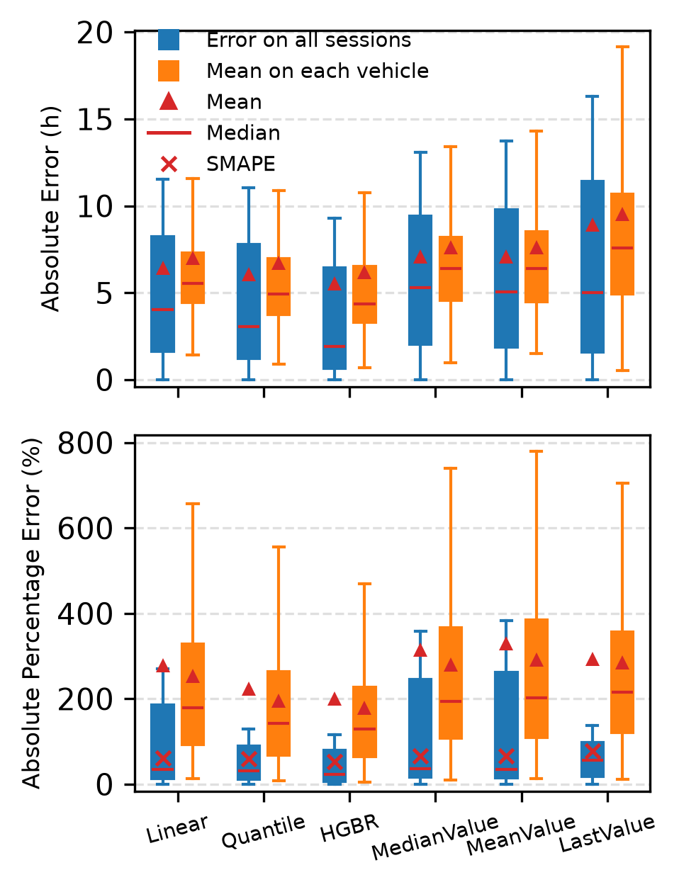

---

## 3. Best Model Error Density & Distribution

Comparison of absolute error density between all sessions and the vehicle-level mean distribution for `HistGradientBoostingRegressor`:

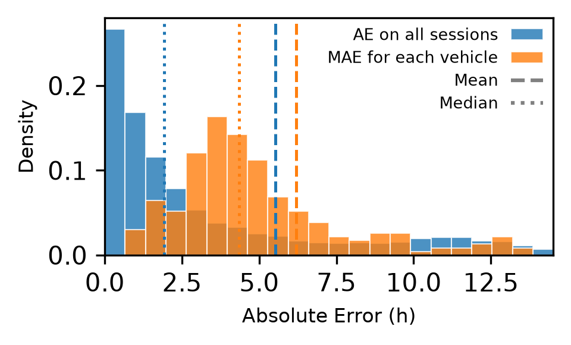

---

## 4. Behavioral & Vehicle-Level Analysis

Ordinary Least Squares (OLS) regression analyzing the dependence of participant-level Median Absolute Percentage Error (MdAPE) on user charging behaviors:

- **Variation of session duration (P90-P10 / Median)**: Slope $a = 13.451$, Intercept $b = 12.414$, $r^2 = 0.064$, $p < 0.0001$ (Statistically significant ($p < 0.05$))
- **Battery size (CarKWh)**: Slope $a = 0.126$, Intercept $b = 33.716$, $r^2 = 0.003$, $p = 0.4278$ (Not statistically significant)
- **Session start hour (StartHour)**: Slope $a = -6.273$, Intercept $b = 139.994$, $r^2 = 0.031$, $p = 0.0053$ (Statistically significant ($p < 0.05$))

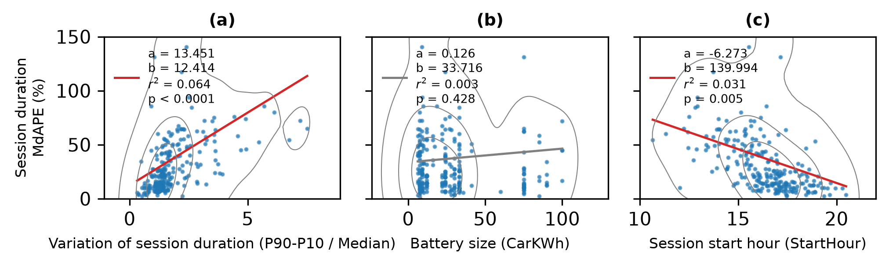

---

## 5. Model Agreement & Multi-Model Comparison

Visual comparison of participant-level Test MAE values between benchmark models (HGBR versus Linear Regression, HGBR versus Quantile Regressor, and Linear Regression versus Quantile Regressor). The main scatter plot displays agreement across all vehicles, while the inset axis zooms into the $[0, 20]$ error range:

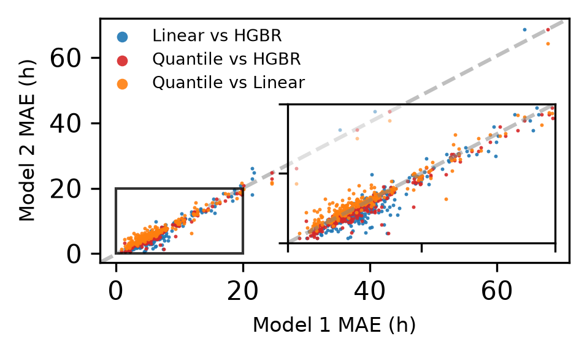

---

## 6. Temporal Stability & Seasonality Analysis

- **Temporal Error Shift Across Test Split:** The relative change in MAE from the first to second half of the test set is calculated per participant as $(\text{mean}(\text{first-half AE}) - \text{mean}(\text{second-half AE})) / \text{mean}(\text{all participant Test AE})$. Across evaluated vehicles, the mean relative change is **-0.068 \pm 0.523**. Under this formula, a negative value indicates that prediction error is higher in the second half of the participant's test sessions than in the first half.
- **Split Data Availability:**
  - **Train split:** 178.3 \pm 139.7 sessions over 298.8 \pm 138.2 days per vehicle.
  - **Test split:** 48.0 \pm 33.2 sessions over 70.5 \pm 17.3 days per vehicle.

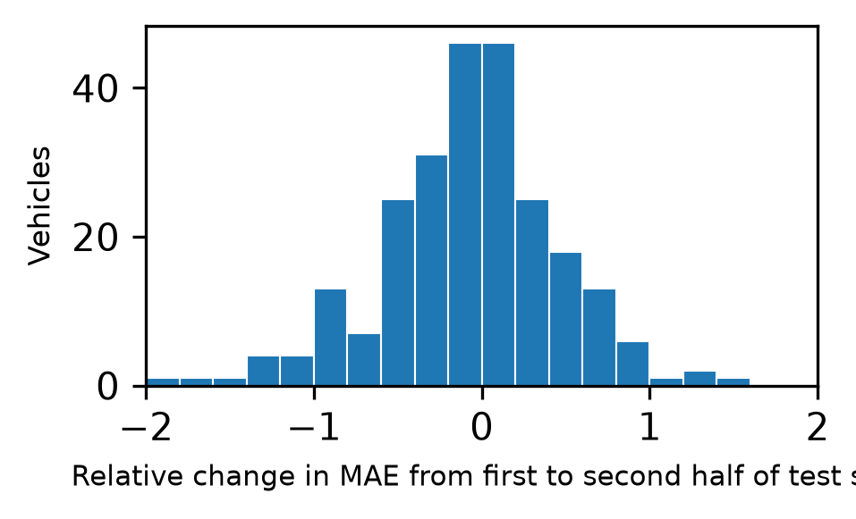

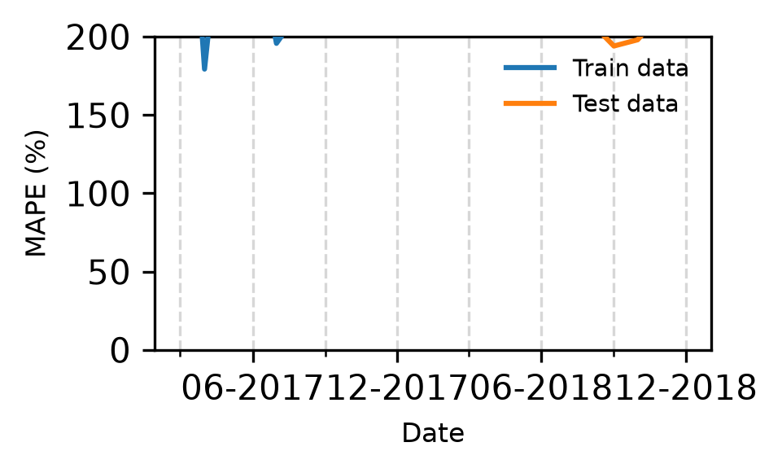

---

## 7. TreeSHAP Explainability & Feature Importance

Global feature importance ranking evaluated via TreeSHAP on test sessions:

| Rank | Feature Name | Mean Absolute SHAP Value |
| :---: | :--- | :---: |
| 1 | `StartSin` | 2.2364 |
| 2 | `LastDuration` | 1.3947 |
| 3 | `CarKWh` | 0.6599 |
| 4 | `StartHourNorm` | 0.6549 |
| 5 | `StartCos` | 0.6021 |
| 6 | `TimeSinceLastStop` | 0.4498 |
| 7 | `CarKW` | 0.2111 |
| 8 | `month` | 0.1585 |
| 9 | `weekday` | 0.1187 |
| 10 | `weekend` | 0.1104 |
| 11 | `LastConsumedkWh` | 0.0967 |
| 12 | `sessionsToday` | 0.0182 |
| 13 | `holiday` | 0.0013 |

Data files: [shap_global_importance.csv](shap_global_importance.csv), [shap_vehicle_importance.csv](shap_vehicle_importance.csv)

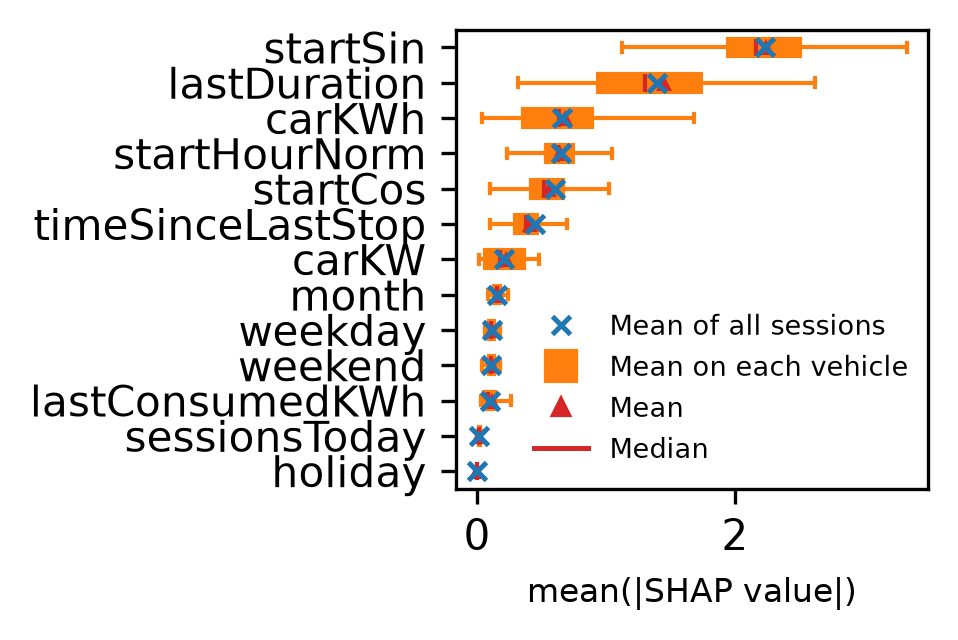

---

## 8. Subgroup Analysis: Same-day vs. Overnight Charging

Independent evaluation comparing same-day charging sessions (where StopTime and StartTime fall on the same UTC calendar date, day difference == 0) against overnight charging sessions (where StopTime falls on a subsequent UTC calendar date, day difference > 0):

| Subgroup | Sessions | Train $N$ | Test $N$ | MAE | MdAE | MAPE (%) | MdAPE (%) | SMAPE (%) |
| :--- | :---: | :---: | :---: | :---: | :---: | :---: | :---: | :---: |
| **All Sessions** | 59,520 | 47,616 | 11,904 | 5.53 | 1.92 | 201 | 23.4 | 52.8 |
| **Same-day Sessions** | 21,436 | 17,148 | 4,288 | 1.35 | 1.02 | 111 | 45.1 | 56.6 |
| **Overnight Sessions** | 38,084 | 30,467 | 7,617 | 4.05 | 1.13 | 15 | 8.33 | 16.9 |

Data file: [same_day_overnight_metrics.csv](same_day_overnight_metrics.csv)

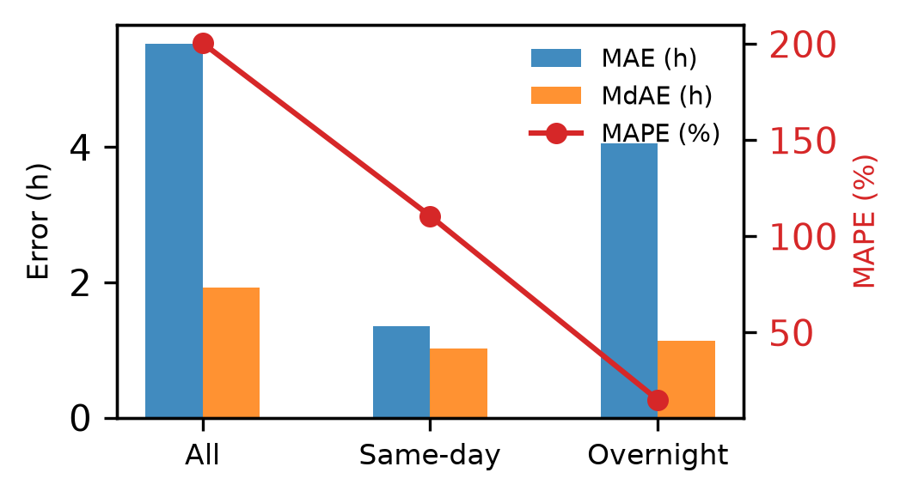

---

## 9. Occupancy Heatmaps (Top Best & Worst Vehicles)

Visual analysis of 15-minute resolution charging occupancy comparing real and predicted plugged-in states (White: True Negative, Orange: False Negative, Red: False Positive, Blue: True Positive):

### Best Performing Vehicles
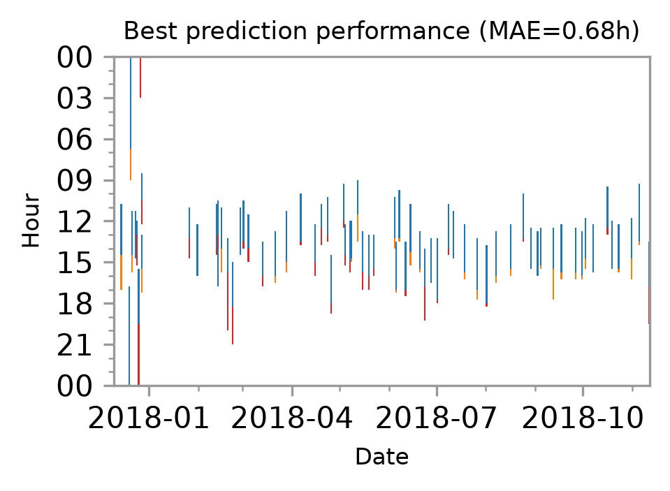  
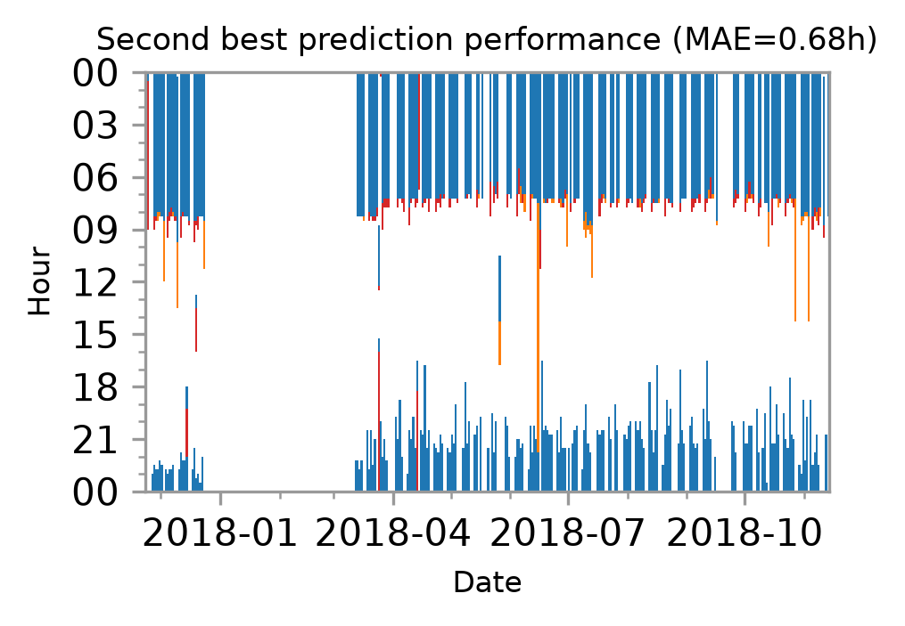  
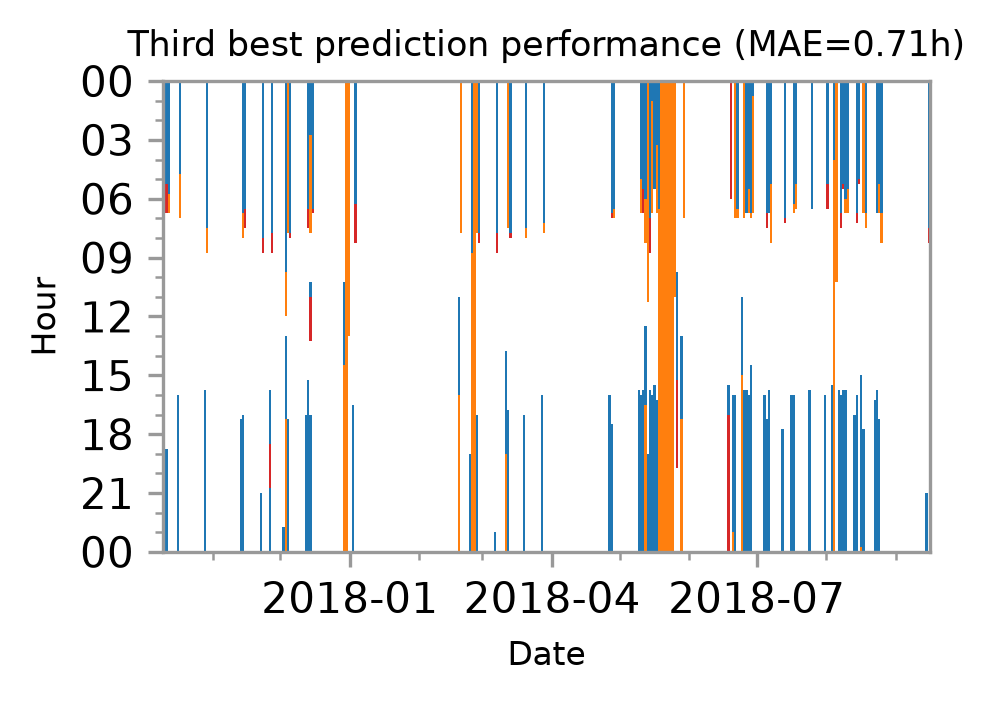  

### Worst Performing Vehicles
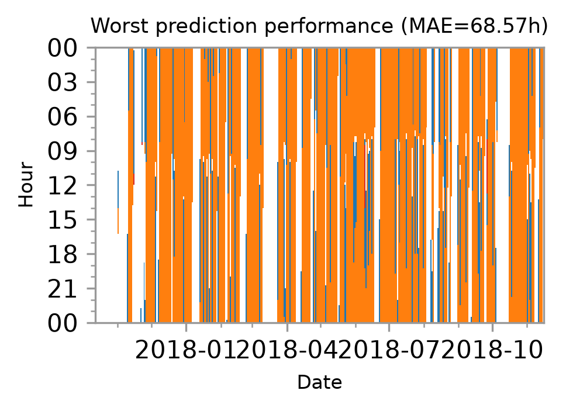  
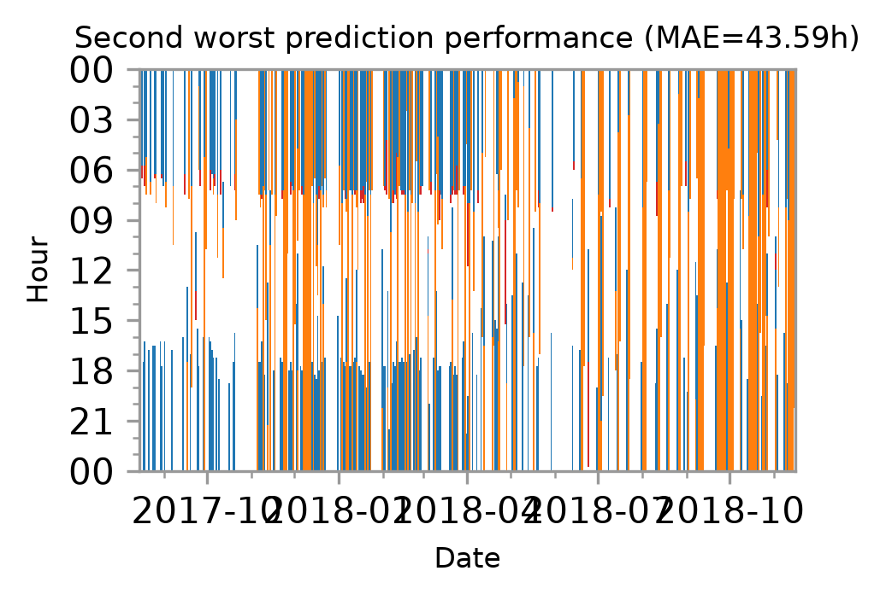  
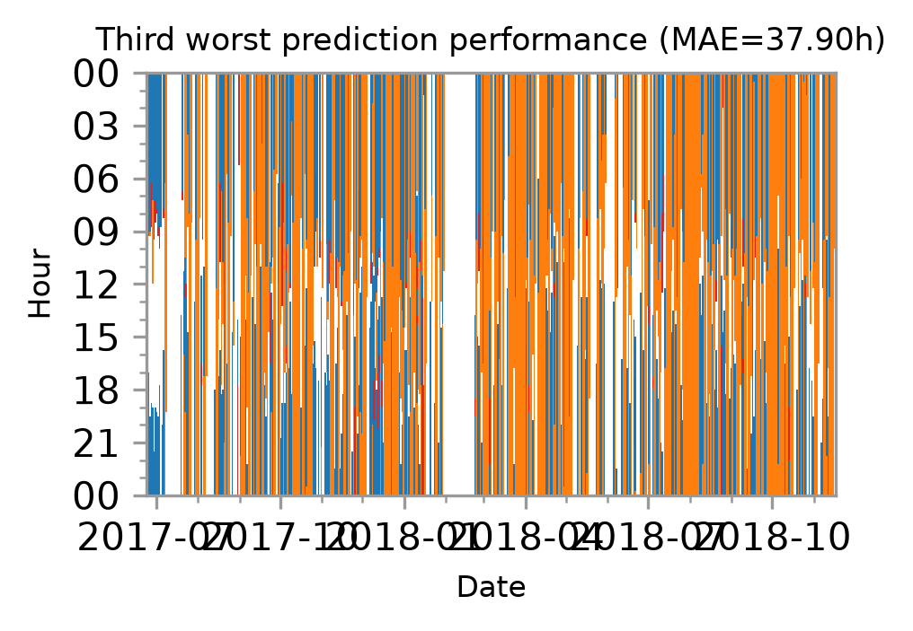  

---

*Report generated automatically by TARANG Stage 3 Model Evaluation Suite.*